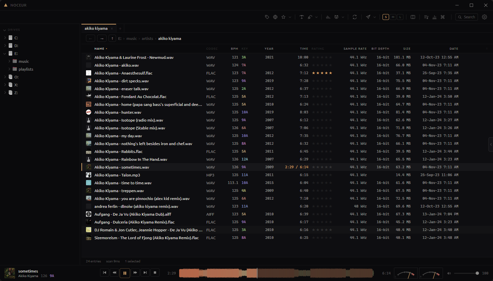

<div align="center">


# Noceur

A music-aware file browser and tagger for Windows, built for DJs.

[](LICENSE)


</div>



Noceur browses your music folders directly. There is no import step and no library database to
keep in sync: the folder tree is the library. Each row shows BPM, key, duration, rating and tags,
and the app includes a player, a tagger, a quality checker and a lossless converter.

It is designed for large collections (20k–100k tracks) spread across several drives, where the
same track often exists in more than one place.

## Features

**Browsing**
- Fast, virtualized listing that handles folders with tens of thousands of files
- Folder tree with pinned folders, breadcrumbs, back/forward history
- Tabs and a dual-pane layout (side by side or stacked), each pane with its own sort and history
- 19 columns, reorderable and resizable; sort by BPM, key, rating, date and more
- Icon view for folders that contain no audio
- Full-text search across the indexed library
- Option to hide non-audio files (cover scans, `.nfo`, `.cue`)

**Files**
- Drag and drop to and from Explorer, between panes, onto tabs, tree folders and folder rows
- Copy, cut and paste (`Ctrl+C` / `Ctrl+X` / `Ctrl+V`), shared with the Windows clipboard, so files copied in Explorer paste in Noceur and vice versa
- `Ctrl` or `Shift` at the drop forces copy or move, as in Explorer
- Copy or move to the other pane; new folder; delete to the Recycle Bin
- File operations go through the Windows shell (progress, conflict prompts, Explorer undo)
- `Ctrl+Z` undoes the last rename job inside the app
- "Open with" your own programs (e.g. Spek, Mp3tag, fre:ac), all selected files in one launch

**Playback**
- Preview player with a seekable three-band waveform (four styles)
- Spectrogram of the playing track, click to seek
- Meters: peak LEDs, VU needles, oscilloscope, vectorscope with phase correlation, spectrum

**Tagging**
- Edit one file or many; fields that differ across the selection are shown as mixed
- Inline editing in the list: click a selected row's name or tag cell to edit it in place
- Star ratings (`Alt+0`–`Alt+5`), stored where DJ software reads them
- Quick tag: apply your own values (energy, mood, …) to the playing track by keyboard
- Metadata from Beatport, Bandcamp, Deezer, iTunes, Discogs and Tidal, and cover art from those plus the Cover Art Archive, always picked by hand
- Untagged files identified by sound (AcoustID fingerprint), then searched by what they turn out to be; the file name is the last resort
- Tags from file name (`%artist% - %title%` patterns, with preview)
- Rename from templates, and cleanup rules for common download debris
- File modification dates are preserved when retagging (configurable)

**Analysis**
- Quality check: detects lossy sources in lossless containers, upscaled MP3s, upsampled files and clipping, with an estimate of the original bitrate
- Duplicate finder based on decoded audio, independent of tags and file names
- BPM and key detection, shown next to the tagged values and written only for the ones you tick; half/double time settled by a range, keys by a neural network (KeyNet) that agrees with Mixed In Key on about two tracks in three

**Conversion**
- Lossless conversion between WAV, AIFF, FLAC and ALAC via ffmpeg
- Keeps bit depth and sample rate, verifies each output against the source (MD5), copies tags and art

**Customization**
- Customizable toolbar: reorder, add or remove buttons, separators and spaces, change icons
- Your own action buttons using foobar2000 title-formatting syntax, with a built-in syntax reference and recipes
- "Search in" sites (Google and YouTube by default, add your own) from the context menu or toolbar
- Seven themes, including one light theme; selectable UI font

## Installation

Requirements: Windows 10 or 11 (64-bit). WebView2 ships with Windows.

There are no pre-built releases yet; [build from source](#building). Installers will be published
on the [Releases](https://github.com/mtsbh/noceur/releases) page.

The app is portable. Settings live in `noceur-config.json` next to the executable, and the index
(`noceur-index.db`) is a cache that can be deleted at any time. Nothing is written to the registry
or `AppData`.

Converting requires [ffmpeg](https://ffmpeg.org/download.html). Put `ffmpeg.exe` next to
Noceur, on your `PATH`, or set its path in Settings → Files.

## Keyboard shortcuts

| Shortcut | Action |
| --- | --- |
| `Space` | Play / pause |
| Double-click | Open folder / play track |
| `F2` | Edit metadata |
| `Del` | Move to Recycle Bin |
| `Ctrl+C` / `Ctrl+X` / `Ctrl+V` | Copy / cut / paste files |
| `Ctrl+Z` | Undo last rename |
| `Ctrl+Shift+N` | New folder |
| `Ctrl+F` | Search |
| `Ctrl+T` / `Ctrl+W` | New tab / close tab |
| `Ctrl+Tab`, `Ctrl+1`–`9` | Switch tabs |
| `Ctrl+\` | Toggle dual pane |
| `Tab` | Switch pane |
| `Alt+←` / `Alt+→` | Back / forward |
| `Alt+0`–`5` | Set rating |
| `T` | Quick tag panel |
| `F1` or `?` | All shortcuts |

Right-click the toolbar and choose **Customize toolbar** to rearrange it.

## Building

Prerequisites: Rust (the toolchain in `rust-toolchain.toml` installs automatically), Node.js 24+,
and the MSVC build tools.

```bash
npm --prefix ui install
npm --prefix ui run build
cargo build --release -p noceur-app --features custom-protocol
```

The executable is written to `target/release/noceur-app.exe`.

> [!IMPORTANT]
> `--features custom-protocol` embeds the frontend in the binary. Without it the build loads the
> Vite dev server and shows a blank "can't reach this page" window. See
> [`docs/building.md`](docs/building.md).

To build the NSIS installer:

```bash
npx @tauri-apps/cli@^2 build --config crates/noceur-app/tauri.conf.json
```

Pushing a `v*` tag builds the installer in CI and attaches it to a draft GitHub release.

For development, run `npm --prefix ui run dev` and start the app with `cargo run -p noceur-app`.

### Tests

```bash
cargo test --workspace
cargo clippy --workspace --all-targets -- -D warnings
cargo fmt --all -- --check
npx --prefix ui tsc --noEmit -p ui/tsconfig.json
npm --prefix ui test
```

All of these run in CI. Tests that need a real music library or network access are marked
`#[ignore]`; run them with `-- --ignored`, for example:

```bash
NOCEUR_SCAN="E:/music" cargo test --release -p noceur-audio --test real_files -- --ignored --nocapture
```

A headless CLI is available for inspecting the index:

```bash
cargo run -p noceur-cli -- ls "E:/music" --sort bpm --audio-only
```

## Project layout

```
crates/
  noceur-fsmodel   enumeration, sorting, long paths, rename templates, title formatting
  noceur-tags      tag reading and writing, key normalization, ratings
  noceur-art       cover art extraction, thumbnails, shell icons
  noceur-audio     playback, waveforms, spectrograms, meters, quality analysis, audio identity
  noceur-online    Beatport, Bandcamp, MusicBrainz, Deezer, iTunes, Discogs, Tidal, Cover Art Archive, AcoustID clients
  noceur-index     SQLite index, scanner, queries, caches
  noceur-app       Tauri application: commands, state, formatting
  noceur-cli       headless debug CLI
ui/                Solid + Vite frontend
docs/              design notes, build notes, troubleshooting
```

Only `noceur-app` depends on Tauri; the other crates build and test without a window.
Design decisions are documented in [`docs/design.md`](docs/design.md).

## Roadmap

Background BPM & key, one-click tag tools and Mp3tag-style converter shortcuts are planned. See [`docs/roadmap.md`](docs/roadmap.md).

## Troubleshooting

See [`docs/troubleshooting.md`](docs/troubleshooting.md).

## Licence

[GPL-3.0-only](LICENSE)
