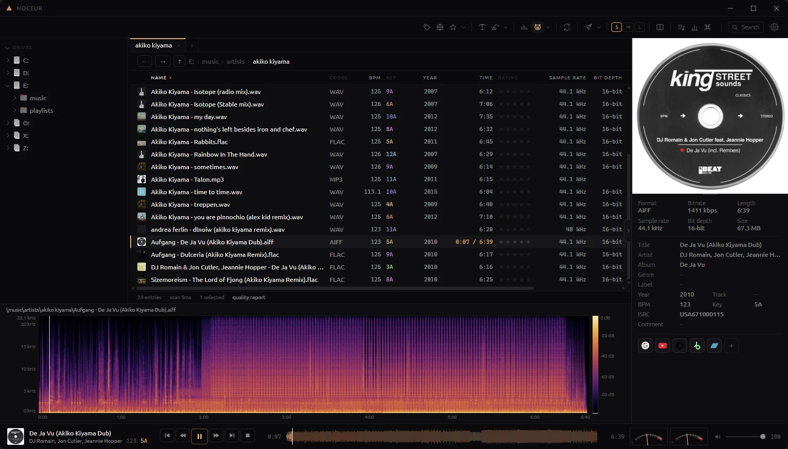
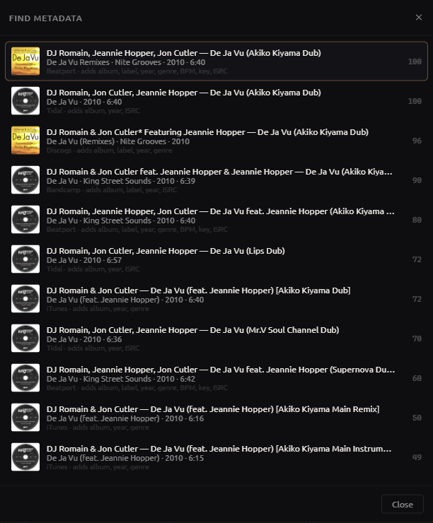
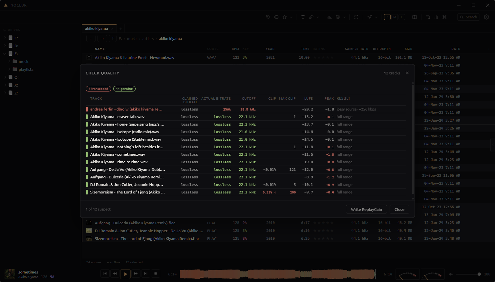
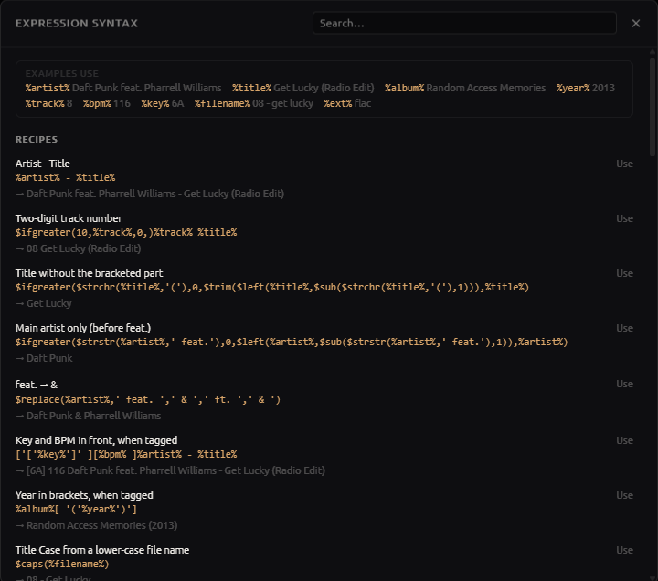
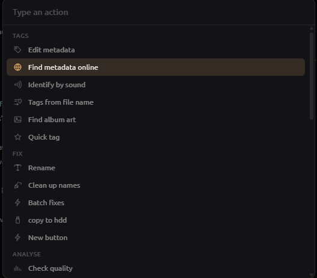

<div align="center">


# Noceur

File explorer meets audio player. Your folders are the library: browse, play and tag in
place, no import needed. Built for DJs and audiophiles.

[](LICENSE)


</div>


## Features

**Browsing**
- Fast, virtualized listing that handles folders with tens of thousands of files
- Folder tree with pinned folders and back/forward history
- Tabs and a dual-pane layout (side by side/stacked), each pane with its own sort and history
- Full-text search across the indexed library
- Option to hide non-audio files (covers, `.nfo`, `.cue`)

**Files**
- Drag and drop to and from Explorer, between panes, tabs, tree folders etc.
- Copy, cut and paste (`Ctrl+C` / `Ctrl+X` / `Ctrl+V`), shared with the Windows clipboard, so files copied in Explorer paste in Noceur and vice-versa
- `Ctrl+Z` undoes the last rename job inside the app
- "Open with" your own programs (e.g. Spek, Mp3tag, fre:ac)
- Playlists (`Ctrl+P`): gather tracks from anywhere without copying them. `P` adds the selection to the current playlist (again takes it out), right-click → Playlists ticks it into any of them; play through in order, reorder by drag or `Alt+↑↓`
- Send to rekordbox (Playlists window): every playlist goes into a `noceur` folder in the `rekordbox.xml` rekordbox's Imported Library reads, with tracks rekordbox doesn't have yet added to its collection, each with a beat grid and up to eight cues (hot and memory) on the bar lines where its sections start, named Intro, Drop, Break or Outro. A track already in the file keeps its own cues. Nothing else in the file changes: the old file is backed up, and every existing track, cue and playlist is checked unchanged before the new one replaces it. Reload in rekordbox, then import as usual
- Track sidebar (`Ctrl+B`, or the tab on the right edge): cover, file specs, tags editable, Artist / Genre / Label as links to every track with that tag, and search icons for the sites ticked in Settings → Search in.
- Send to Telegram: the selected files open in Telegram Desktop's chat picker, sent from your own account (button hidden when Telegram isn't installed)

**Playback**
- Preview player with a seekable three-band waveform (four styles)
- Spectrogram of the playing track, seekable on click
- Meters: peak LEDs, VU, oscilloscope, vectorscope with phase correlation, spectrum



**Tagging**
- Edit one file or many; fields that differ across the selection are shown as mixed
- Inline editing
- Star ratings (`Alt+0`–`Alt+5`), stored where DJ software reads them
- Quick tag: apply your own values (energy, mood, …) to the playing track by keyboard
- Pick metadata from Beatport, Bandcamp, Deezer, iTunes, Discogs and Tidal, and cover art from those plus the Cover Art Archive
- Untagged files identified by sound (AcoustID fingerprint, then Shazam for new or underground releases AcoustID doesn't know)
- Tags from file name: reads tags out of the name (`%artist% - %title%` patterns, with preview)
- Rename: the other way round, writes the file name from tags using templates; Clean up renames to `Artist - Title`
- Actions, previewed old → new: clean tags, removing (Original Mix) or trailing brackets, tidy featuring, cut N characters off the name etc.
- Add your own buttons built by picking a field and an operation; Mp3tag expressions (`$regexp`, `$cutLeft`, `$cutRight`, `$eql`) run as pasted
- You can keep file modification dates when retagging



**Analysis**
- Quality check: detects lossy sources in lossless containers, upscaled MP3s, upsampled files and clipping (also when it was turned down afterwards), with an estimate of the original bitrate
- Damage check: files cut short of their stated length, decode errors, dropouts, clicks and 16-bit audio padded to 24, in the same pass
- Loudness: integrated LUFS and true peak (ITU-R BS.1770 / EBU R128) in the quality report, and optionally written as ReplayGain
- Duplicate finder based on decoded audio, independent of tags and file names
- BPM and key detection, shown next to the tagged values and written only for the ones you tick; half/double time settled by a range, keys by a neural network (KeyNet) - pretty much same as Mixed in Key.
- Library overview (`Ctrl+I`): tracks and playing time, BPM spread, keys on a Camelot wheel, formats and sample rates, quality and loudness, missing tags and top labels
- Optional: BPM and key measured automatically for each track you play, written only into empty fields (or shown, or overwritten), with marking where a tag disagrees



**Conversion**
- Lossless conversion between WAV, AIFF, FLAC and ALAC via ffmpeg
- Keeps bit depth and sample rate, verifies each output against the source (MD5), copies tags and art

**Customization**
- Customizable toolbar: reorder, add or remove buttons, separators and spaces, change icons
- Your own action buttons using foobar2000 title-formatting syntax, with a useful built-in syntax reference and recipes
- "Search in" sites (Google and YouTube by default, you can add your own) from the context menu or toolbar
- Choose between dark and light themes + UI font
- Command palette (`Ctrl+K`): every action, including your own buttons, by typing

<p>


</p>

## Installation

Requirements: Windows 10 or 11 (64-bit)

There are no pre-built releases yet; [build from source](#building). Installers are published
on the [Releases](https://github.com/mtsbh/noceur/releases) page.

The app is portable. Settings live in `noceur-config.json` next to the executable, and the index
(`noceur-index.db`) is a cache that can be deleted at any time. Nothing is written to the registry
or `AppData`.

Converting requires [ffmpeg](https://ffmpeg.org/download.html). Put `ffmpeg.exe` next to
Noceur, on your `PATH`, or set its path in Settings.

## Keyboard shortcuts

| Shortcut | Action |
| --- | --- |
| `Space` | Play / pause |
| Double-click | Open folder / play track |
| `↑` `↓` `Home` `End` `PgUp` `PgDn` | Move in the list (`Shift` extends the selection) |
| `Enter` / `Backspace` | Open folder or play / parent folder |
| `Ctrl+A` | Select all |
| `F2` | Edit metadata |
| `Alt+F1` | Tags from file name (`Artist - Title`) |
| `Alt+F2` | File name from tags (`Artist - Title`) |
| `Alt+F3` | Find metadata |
| `Del` | Move to Recycle Bin |
| `Ctrl+C` / `Ctrl+X` / `Ctrl+V` | Copy / cut / paste files |
| `Ctrl+Z` | Undo last rename |
| `Ctrl+Shift+N` | New folder |
| `Ctrl+F` | Search |
| `Ctrl+K` | Command palette |
| `Ctrl+I` | Library overview |
| `Ctrl+P` | Playlists |
| `Ctrl+B` | Track sidebar (selecting plays while open) |
| `P` | Add to / remove from current playlist |
| `Ctrl+T` / `Ctrl+W` | New tab / close tab |
| `Ctrl+Tab`, `Ctrl+1`–`9` | Switch tabs |
| `Ctrl+\` | Toggle dual pane |
| `Tab` | Switch pane |
| `Alt+←` / `Alt+→` | Back / forward |
| `Alt+0`–`5` | Set rating |
| `T` | Quick tag panel |
| `F1` or `?` | All shortcuts |

Right-click the toolbar and choose **Customize toolbar** to rearrange it.

## Building

Prerequisites: Rust (the toolchain in `rust-toolchain.toml` installs automatically), Node.js 24+,
and the MSVC build tools.

```bash
npm --prefix ui install
npm --prefix ui run build
cargo build --release -p noceur-app --features custom-protocol
```

The executable is written to `target/release/noceur-app.exe`.

> [!IMPORTANT]
> `--features custom-protocol` embeds the frontend in the binary. Without it the build loads the
> Vite dev server and shows a blank "can't reach this page" window. See
> [`docs/building.md`](docs/building.md).

To build the NSIS installer:

```bash
npx @tauri-apps/cli@^2 build --config crates/noceur-app/tauri.conf.json
```

Pushing a `v*` tag builds the installer in CI and attaches it to a draft GitHub release.

For development, run `npm --prefix ui run dev` and start the app with `cargo run -p noceur-app`.

### Tests

```bash
cargo test --workspace
cargo clippy --workspace --all-targets -- -D warnings
cargo fmt --all -- --check
npx --prefix ui tsc --noEmit -p ui/tsconfig.json
npm --prefix ui test
```

All of these run in CI. Tests that need a real music library or network access are marked
`#[ignore]`; run them with `-- --ignored`, for example:

```bash
NOCEUR_SCAN="E:/music" cargo test --release -p noceur-audio --test real_files -- --ignored --nocapture
```

A headless CLI is available for inspecting the index:

```bash
cargo run -p noceur-cli -- ls "E:/music" --sort bpm --audio-only
```

## Project layout

```
crates/
  noceur-fsmodel   enumeration, sorting, long paths, rename templates, title formatting
  noceur-tags      tag reading and writing, key normalization, ratings
  noceur-art       cover art extraction, thumbnails, shell icons
  noceur-audio     playback, waveforms, spectrograms, meters, quality analysis, audio identity
  noceur-online    Beatport, Bandcamp, MusicBrainz, Deezer, iTunes, Discogs, Tidal, Cover Art Archive, AcoustID, Shazam clients
  noceur-index     SQLite index, scanner, queries, caches
  noceur-rekordbox rekordbox.xml export: playlists, beat grids, hot and memory cues
  noceur-app       Tauri application: commands, state, formatting
  noceur-cli       headless debug CLI
ui/                Solid + Vite frontend
docs/              build notes, troubleshooting
```

Only `noceur-app` depends on Tauri; the other crates build and test without a window.

## Status

Noceur is at version 0.2 and is developed against one large, real DJ library. It is used
every day, but it has not had wide testing yet. It runs on Windows only: file operations,
the clipboard, shell icons and drag and drop go through Windows APIs. Back up anything you
can't afford to lose before you batch-retag or rename it.

## Troubleshooting

See [`docs/troubleshooting.md`](docs/troubleshooting.md).

## Contributing

Issues and pull requests are welcome. Before you open a pull request, make sure everything
under [Tests](#tests) passes, and keep each change to one topic. For larger changes, open an
issue first.

## Acknowledgements

- Key detection runs [KeyNet](https://github.com/a1ex90/MusicalKeyCNN) (Korzeniowski & Widmer,
  ISMIR 2018) with weights retrained by
  [OpenKeyScan](https://github.com/rekordcloud/openkeyscan-analyzer). Both are MIT-licensed; see
  [`crates/noceur-audio/models/README.md`](crates/noceur-audio/models/README.md).
- Fingerprints come from [rusty-chromaprint](https://github.com/darksv/rusty-chromaprint), and
  lookups use [AcoustID](https://acoustid.org).
- Built with [Tauri](https://tauri.app), [Solid](https://www.solidjs.com),
  [Symphonia](https://github.com/pdeljanov/Symphonia), [Lofty](https://github.com/Serial-ATA/lofty-rs)
  and [SQLite](https://sqlite.org).

## Disclaimer

Noceur is not affiliated with AlphaTheta (rekordbox), Mixed In Key, Beatport, Bandcamp, Deezer,
Apple, Discogs, Tidal, Shazam or MusicBrainz. Beatport, Bandcamp and Shazam are reached through
their public websites rather than published APIs, so a change on their side can break a source
until Noceur is updated.

## Licence

[GPL-3.0-only](LICENSE)
